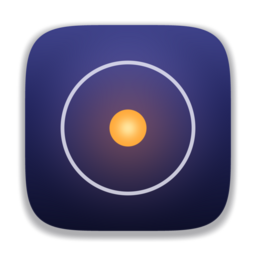
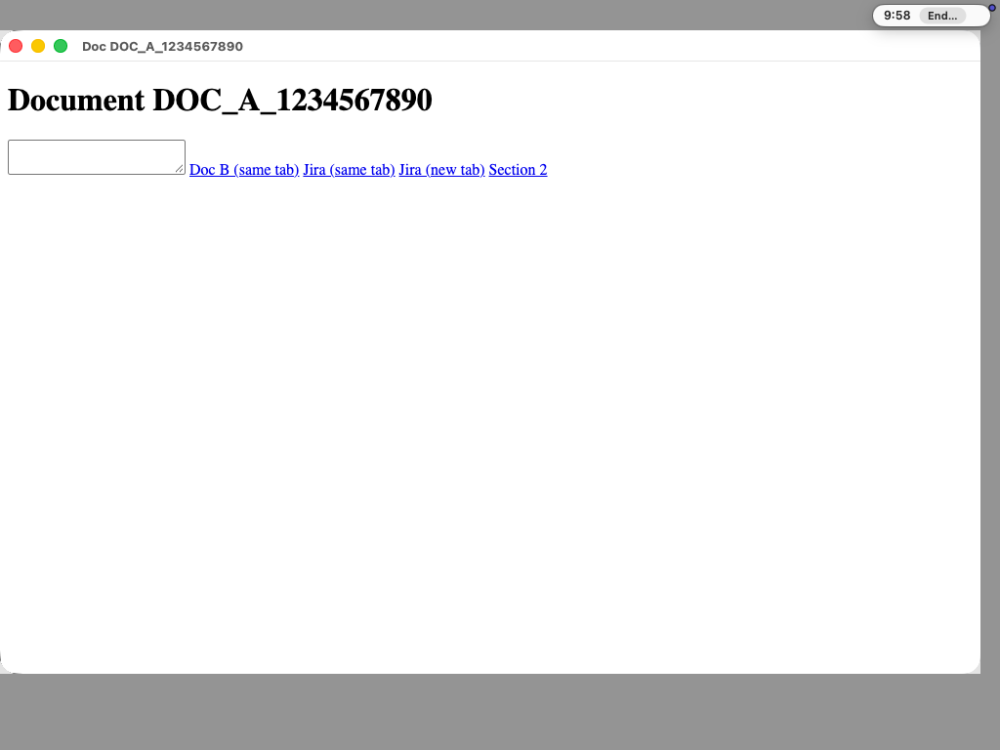
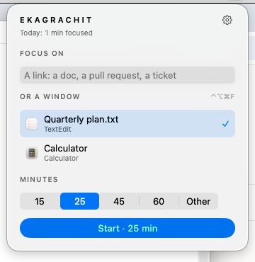
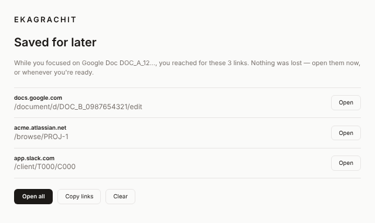
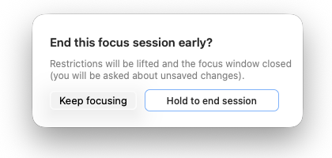

<p align="center"></p>

<h1 align="center">Ekagrachit</h1>
<p align="center"><b>One thing. One window. Nothing else.</b><br>
<a href="https://thunderboltsid.github.io/ekagrachit/">Website</a> ·
<a href="https://github.com/thunderboltsid/ekagrachit/releases/latest">Download</a> ·
<a href="docs/installation.md">Install guide</a> ·
<a href="PRIVACY.md">Privacy</a></p>

**A deep-focus tool for people whose distractions are productive apps.**

Ekagrachit (एकाग्रचित्त, *one-pointed attention*) runs on macOS. You give it
the one thing you want to work on and a duration:

- **any Mac window**: a Word or Pages document, a spreadsheet, a deck, your
  editor (VS Code, Cursor, Xcode, IntelliJ), your terminal (Terminal, iTerm2,
  Warp, Ghostty);
- **or a web page** in Google Chrome: a Google Doc, a GitHub or GitLab pull
  request, a Jira or Linear issue, a Notion page, a Figma file, Confluence,
  Miro, Overleaf, Colab, Office for the web, or any other page.

Every other window, tab, site and app stays out of reach until the time is up.

It is not a website blocker. Jira isn't "bad"; it just isn't what you chose
to work on for the next 45 minutes.

The name comes from the Bhagavad Gītā and Patañjali's Yoga Sūtras: *ekāgra*,
the one-pointed mind, "a lamp sheltered from the wind." [What the name means →](https://thunderboltsid.github.io/ekagrachit/#name)



## Starting

- Click ◎ in the menu bar. What you were just working on is already chosen:
  the Chrome tab you were reading, or the window you were in.
- Or press **⌃⌥⌘F** to focus whatever window is in front.
- Or from Shortcuts, Raycast, Alfred or a script:
  `open "ekagrachit://focus?window=front&minutes=50"`,
  `ekagrachit://focus?app=com.microsoft.VSCode`,
  `ekagrachit://focus?url=https://…`. (There is deliberately no URL to end
  a session.)

## What happens during a session

- **Only your window.** An app window stays where it is; a web page opens in a
  dedicated Chrome window with no tab strip. Everything inside keeps working:
  editing, comments, an editor's file tabs, a terminal's tabs.
- **Web pages: off-target links never load.** Navigations away from the page
  are blocked before a request is made; new tabs and windows are closed. Each
  web app is recognised by what you're working on (the Google Doc, the PR,
  the Figma file), not by its exact address.
- **Apps: other windows can't take over.** A new window of the same app (⌘N)
  or of another app is covered, and you're returned to yours.
- **Saved for later.** Every link you reach for is kept. The pill says
  *Saved for later: github.com*, and the full list appears when the session ends.
- **Everything else disappears.** Other apps, the Dock and the menu bar are
  covered on every display and Space. Cmd-Tab, Mission Control, Stage Manager
  and other Spaces all lead back to your window.
- **Deliberate exit.** ⌃⌥⌘E (or *End…* in the pill), then hold for 2.5 s.
- **Robust.** Survives sleep, browser and app restarts. Changing the clock
  can't extend a session. Pages with unsaved changes are never closed without
  asking.
- **Private.** Everything stays on your Mac: no account, no telemetry, no
  network requests. Page and window contents are never read.

| Start | Saved for later | End early |
|---|---|---|
|  |  |  |

## Install

Requires **macOS 26 Tahoe on Apple Silicon**. Focusing web pages also needs **Google Chrome**.

1. Download `Ekagrachit-<version>.dmg` from the
   [latest release](https://github.com/thunderboltsid/ekagrachit/releases/latest)
   and drag Ekagrachit to Applications.
2. Open it. The setup window walks you through the rest:
   - allow Accessibility;
   - for web pages, load the Chrome extension: turn on Developer mode in
     `chrome://extensions`, then drag in the folder Ekagrachit shows you.

The first time you open the app, macOS asks you to confirm it (System
Settings → Privacy & Security → **Open Anyway**), because builds are not yet
notarized. Details and troubleshooting are in [docs/installation.md](docs/installation.md).

## Build from source

```bash
git clone https://github.com/thunderboltsid/ekagrachit && cd ekagrachit
scripts/install.sh          # builds the extension + app, installs to ~/Applications
```

| | |
|---|---|
| `extensions/chrome/` | MV3 extension (TypeScript): identity policy, blocking rules, session controller |
| `apps/macos/Sources/EkagrachitCore/` | Platform-independent Swift: state machine, deadlines, protocol, IPC, geometry |
| `apps/macos/Sources/EkagrachitApp/` | Menu bar app (SwiftUI + AppKit): overlays, focus loop, setup |
| `apps/macos/Sources/EkagrachitHost/` | Chrome Native Messaging host (stdio ↔ Unix socket relay) |
| `docs/` | Website and documentation ([architecture](docs/architecture.md), [protocol](docs/protocol.md), [limitations](docs/limitations.md), [testing](docs/testing.md), [development](docs/development.md)) |

Every push runs:
- extension unit tests and Chromium end-to-end tests;
- Swift tests on Linux and macOS;
- a desktop suite on a real macOS 26 runner. It drives the real app, Chrome
  and extension, and checks the results through the window server and
  screenshot pixels.

See [docs/testing.md](docs/testing.md).

Releases: run `scripts/set-version.sh X.Y.Z`, commit, and push tag `vX.Y.Z`.
CI builds, verifies and publishes the DMG and extension zips.

## License

MIT. See [LICENSE](LICENSE).
